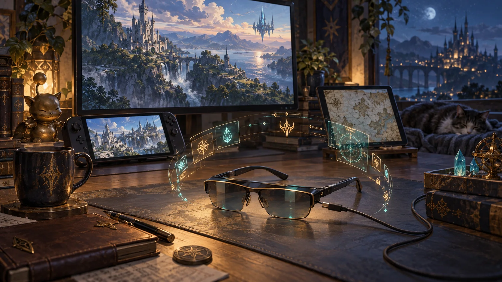
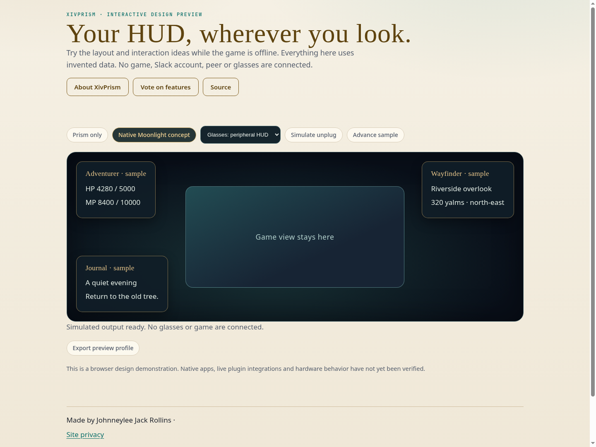

# XivPrism

Your HUD, wherever you look.

A companion HUD project for glasses, extra monitors, phones and tablets. A standalone Prism app and combined presentation in native Moonlight share the same layouts.



**Status: interactive design preview.** The source builds a browser preview with invented data. There is no installable Dalamud release, live game integration, or verified hardware support yet. The illustration is AI-generated concept artwork, not a screenshot or hardware photograph.

[Project site](https://spacegho.st/mods/ffxiv/xivprism/) · [Try the preview](https://spacegho.st/mods/ffxiv/xivprism/preview/) · [Vote on features](https://spacegho.st/mods/ffxiv/xivprism/vote/) · [Roadmap](ROADMAP.md) · [Architecture](docs/architecture.md)

## Build and run the preview

Node 22 or later is required. Authored browser code and build tooling are native Imba, precompiled to committed JavaScript. Third-party compiler dependencies remain unchanged.

```sh
npm ci --ignore-scripts
npm run build
npm run check
python3 -m http.server 8080 --directory preview
```

Open `http://localhost:8080`. The preview connects to no game, Slack account, network peer or glasses. It uses no credentials. Draft/profile exports describe preview state only.

## Browser preview capture



Captured in Chromium. This is a design demonstration, not a live game or account connection.

## Planned experience

- **A second HUD, on your side of the connection.** Keep FFXIV on its game screen and place selected information in your glasses or another display. Fedora supplies game state; display detection belongs to your remote client. Alienware and Win Max 2 can also supply local game state when playing natively.
- **An app when you just want Prism.** The planned standalone Prism Display app receives HUD information without opening Moonlight. Phone, tablet, desktop and glasses outputs can have different layouts. A browser preview below demonstrates the layout choices with invented data.
- **Native Moonlight, with Prism around the game.** Combined mode is planned for native Moonlight applications. Ordinary overlays will be evaluated where supported; restricted platforms may need a Prism-enabled native Moonlight build. Beam and neckband presentation must be checked on the exact model before support is claimed.
- **Peripheral first, pinned afterward.** Start with sparse, readable panels and a clear centre. Whole-surface pinning can use capabilities already supplied by the glasses. Independent spatial panels and physical-monitor alignment are later work, depending on tracking and calibration.
- **Remember the glasses you actually use.** Associate a display with a profile once. During an active companion session, plugging in those glasses should activate that profile. Unplugging, stale data and viewer failure must close the output and release any optional native HUD relocation.
- **The HUD family, connected.** Journal, Character, Wayfinder and Piano are planned panel sources. XivMcp will report viewer readiness, actual presentation and recovery state. The display feed will be independent of high-frequency MCP tool calls.
- **Compatibility is a test record.** Windows clients, Android phone and wearable clients, and iPadOS are targets. Ordinary display output, simultaneous Moonlight use, whole-surface pinning and spatial panels are separate capabilities. No glasses model, native companion app or live game connection has been verified yet.

## Publication and validation

The canonical website registry and ballots are maintained in [ghostty-vote](https://github.com/Spaceghost/ghostty-vote). `metadata/project.json` records this project's identity and honest publication state. `metadata/feature-catalogue.json` mirrors the initial public ballot. No release archives or plugin installer entries are published for this preview.

The CI verifies precompiled output and builds the browser preview. Real game, account, display, hotplug and input checks remain acceptance work, tracked in the roadmap.

Made by Johnneylee Jack Rollins. An independent fan project, not affiliated with Square Enix or hardware/service vendors. Source is MIT licensed; generated artwork attribution is in `docs/art/provenance.json`.
